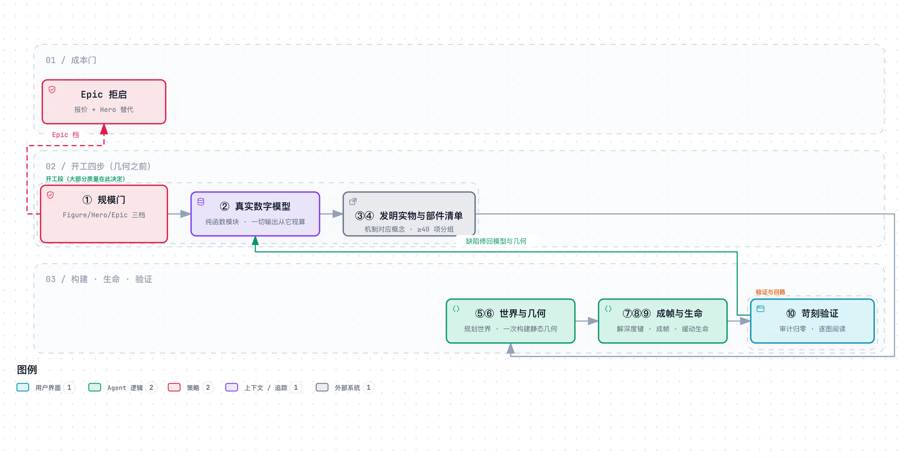

# Anatomy Skill 精读与通俗拆解

> [1] R. [@wheresryan22], "Anatomy: A Claude skill that explains an idea by building it as a real, working object," GitHub 仓库，commit `bc943e4`，2026-10-15。[Online]. Available: <https://github.com/wheresryan22/anatomy>（含 SKILL.md 与 references/ 九篇，正文引用以文件名定位；官网 [2] 与第三方实测 [3] 佐证。仓库 2026-10-10 发 1.0.0，本文所据为截至 2026-10-15 的 main 分支钉版——钉版即把材料固定在某次具体提交上取证，此后引用都以该版本为准。）

**一句话定位**：Anatomy 是一个教 AI「把抽象概念画成一台真实运转的等距机器、并用机器可证的手段保证这台机器放大四倍也无穿帮」的 agent skill——图解的可信度不靠在提示词（prompt：发给 AI 的指令文本）里恳求，靠「真实数字单一模型 + 几何审计归零 + 逐图自验」三条硬机制挣来。

**SCQA 导读**（情境—冲突—问题—答案的展开顺序）：共识背景是 AI 已经很会画「看着像图解」的东西。痛点是放大一看全是穿帮——线悬在半空、管子穿过钢板、读数和画面对不上，而且这些毛病在正常大小的人眼检查里根本看不见。本文回答的问题是「一个 skill 怎么把『物理上可信、数字为真』变成可机器执法的工序」。第 1–2 章拆问题与全貌，第 3–7 章逐个拆五组核心机制（规模门与开工四步、深度键与几何审计、审计到零与反糊弄、验证工具箱、慢与快的经济学），第 8–9 章给实测数字与动手实验室，第 10 章以后是规律、争议、边界与自测。本仓（vibe-video）能借鉴什么，见[机制映射报告](./anatomy-skill-mapping.md)。

> [!TIP]
> **白话主线**：AI 画图解的老毛病是「标注框加箭头」，放大全是穿帮。难在两点：图解的可信感来自物理合理性，而生成不保证物理一致；毛病藏在四倍放大里，连作者本人也是放大才看见第一版发动机图有 54 处穿透、323 处画反。思路是三管齐下：先把真实数字做成一个纯函数模型，让画面、指针、读数全部从它现算——想不一致都不可能；再让每个部件把真实三维形状登记给审计程序，由机器量深度、解不等式定绘制顺序，十一类缺陷全部归零才放行；最后用无头浏览器截图、查每条线的端点、双主题四倍裁切逐张读图，补机器看不见的毛病。验证靠实测对比：323 处降到 0、CI（提交时自动跑的检查）里每个范例重建必须与提交页逐字节一致（本机复跑同样通过）。

**目录**：1. 它要解决什么问题 · 2. 全貌解剖 · 3. 开工四步：规模门、真实数字、发明实物、部件清单 · 4. 深度键：让「谁画在前面」可被证明 · 5. 审计到零：状态空间与反糊弄 · 6. 验证如苛刻评审 · 7. 慢与快的经济学 · 8. 关键实证数字 · 9. 动手实验室 · 10. 底层规律与核心争议 · 11. 适用边界 · 12. 用户自测与费曼研讨套件 · 13. 与本仓的关联 · 参考

## 1. 它要解决什么问题

先讲清三个前置词。**Agent skill** 是一种代理技能包：一个文件夹，根下放 `SKILL.md` 声明名字、触发条件和兼容性，正文只写工作流与硬规则，长篇细则放 `references/` 子目录按需加载——AI 平时只看入口文件，用到哪篇读哪篇。**等距投影**是一种无透视的画法：相机默认从 30° 俯角平行往下看（方位角默认 45°，两者都随主体调整），物体不因远近缩水，整张图没有消失点。**画家算法**是由远及近逐个画实心形状、近者盖住远者的绘制方式——等距图里「谁近谁远」不需要透视计算，只需要一个稳定的绘制顺序。

Anatomy 的输入是一个概念加一组真实数字（「令牌桶限流（一种控制请求速率的算法），桶容量 20、每秒补 5」），输出一件可交互的图解产物（独立 HTML 页、单个 SVG 矢量图文件或 React 网页组件）：一台虚构却真实的机器（一台试验台、一把锁、一排抽屉柜），观者拖动它、看零件联动，屏幕角落的读数实时跳动。设计规格四条：

| 规格 | 通俗版 | 对应机制 |
| :--- | :--- | :--- |
| 实物即解释 | 不画框和箭头，画一台机制与概念一一对应的真机器 | 「The object is the explanation」+ 失败模式治愈对（§3） |
| 数字为真 | 图上每个数都从同一个模型现算，读数与画面不可能打架 | truth-first 纯函数模型（§3）+ 深度键审计（§4） |
| 放大四倍仍耐看 | 每个区域都有真零件，线有归宿、曲面着色平滑 | 部件清单 ≥40 + 工艺硬规则（§3、§6） |
| 自验如苛刻评审 | 机器审计归零 + 浏览器截图逐张读 | audit 十一类归零（§5）+ verify 工具箱（§6） |

它明确不做的事：不是图表库（无数轴无数据序列）、不画人和精确地图、不提供解说旁白（这条边界与视频科普路线的分野见 §10 争议三）。

## 2. 全貌解剖

| 层级 | 部分 | 回答的问题 | 性质 |
| :--- | :--- | :--- | :--- |
| 地基与核心 | ① 实物即解释 + 两条失败模式（太抽象/太平板）与同一治愈 | 图解为什么必须是真机器 | 精读 |
| 地基与核心 | ② 十步工作流（前四步在动笔之前决定大部分质量） | 活怎么排、为什么这个顺序 | 精读 |
| 地基与核心 | ③ 真实数字先行：一个模型的三次出场 | 数字从哪来、为什么不会互相矛盾 | 精读 |
| 地基与核心 | ④ 几何审计：登记形状、量深度、解键、归零放行 | 物理一致性怎么被机器证明 | 精读 |
| 地基与核心 | ⑤ 验证工具箱：截图、行端、裁切、墨量 | 机器看不见的毛病怎么抓 | 精读 |
| 证据链群 | craft.md 反模式与真实事故、CHANGELOG 五天进化史、五道评测题、CI 逐字节重建、审计线植入故障自证 | 这些机制真的抓到过虫吗 | 评判真伪 |
| 领域地图 | Agent Skill 格式、skills 安装生态、社区画廊与发布沙箱 | 它在技能生态里的位置 | 背景 |

因果脉络一条线读下来：**观察**（AI 图解四倍放大下穿帮）→ **归因**（可信感=物理合理+数字为真，生成不保证二者，且 1× 肉眼与作者自己都看不见——作者自认「很会建这类图、但不总擅长看它们」[2]，第三方实测同样发现产出不能保证处处正确 [3]）→ **设计规格**（真实数字先行 × 实物映射 × 构造性同源（全部输出从同一模型现算，见 §3）× 渲染（把数据画成画面）前机器证明 × 苛刻自验）→ **机制**（十步工作流，见下图）→ **证据闭环**（323→0、逐字节重建、每条审计线有植入故障自证）。全貌工作流图如下（图源与交互版链接见图注），一句话说破图意：前四步产出「真相与清单」，中间三步把清单变成几何并交给审计解键，后三步上浏览器与放大镜；箭头回到第 2 步的回路是全部设计的关键——审计发现的问题修在几何与模型，而不是修在绘制顺序上。

<picture>
  <source media="(prefers-color-scheme: dark)" srcset="../diagrams/anatomy--workflow/anatomy--workflow-dark.png">
  
</picture>

> 图源（可 diff 文本）：[`anatomy--workflow.mmd`](../diagrams/anatomy--workflow/anatomy--workflow.mmd) · 交互版（下载到本地打开）：[`anatomy--workflow.html`](../diagrams/anatomy--workflow/anatomy--workflow.html)

最值得按序学习的五个焦点：**真实数字先行**（构造性同源是全文最强机制）、**几何审计与状态空间采样**、**规模/成本门控行为学**、**失败驱动的规则沉淀**、**范例即规格与逐字节确定性**。前置概念（agent skill、等距投影、画家算法）已在 §1 就地讲清。

## 3. 开工四步：规模门、真实数字、发明实物、部件清单

痛点实情：一次请求可能半小时搞定，也可能烧掉六小时——用户不知道自己将付出什么，AI 也不会中途报警。Anatomy 把「接活」本身变成四道工序，且明说「大部分质量在这四步决定，此时还没有任何几何」。

**第一步，先报尺寸再动笔。** [1]（SKILL.md）三档：Figure（一个机构、40–80 个部件）不问直接做，也不向用户报时间——因为实测常常远快于预估，后来的更新干脆把这一档的时间报价删了；Hero（80–150 部件）先说「大约 2–4 小时」再动手；Epic（整车整厂、6 小时起）**不启动**——给估价、提出一个保留核心思想的 Hero 版替代、列明完整版会多什么，用户明确选了才做。无论哪档，第一个小时内必须有一个能在浏览器打开的可用页面，从这里往深做；每步开始跑一次 `date` 记时间戳，某步超过它那份预算的两倍就向用户报告进度与剩余。

**第二步，真实数字先行。** 把要讲的东西的真实数字收齐——尺寸、数量、阈值、曲线——写成一个小的纯函数模块（范例里叫 `rig.ts`）。之后图上每一个数字都从这个模型算出来：指针角度按被测量现算（最小范例里是量块高度除以每圈 20px，生产范例 test-rig 的表盘读倾斜量），读数文字每帧从弹簧当前位置取，无障碍朗读文本取自同一个状态。这叫**构造性同源**：像三个报时员都看同一座母钟报时，而不是各戴一块表互相对表——想报出不同时间都难（这个比方到此为止：母钟自己走错时，三个报时员会一致地报错，同源保证一致、不保证正确）。反面是真事：第一版 Raptor（skill 自带的火箭发动机范例）读数声称 8 根线、画面画了 11 根——读数手写、画面另写；修法是把每根线推进一个列表，读数从列表长度算。更隐蔽的坑是取数时机：读数必须取「零件现在真实在哪」，不能取「目标值」——弹簧有过渡过程，指针落后于目标，从目标取数会在阀门 92 bar（bar：压强单位）才开的机器上提前打出「已泄压 85 bar」。

**第三步，发明实物。** 选一台机器、工具或仪器，其机制与概念一一对应，一句话说清「什么在动、动意味着什么」。概念到实物的映射表是 skill 的核心资产：缓存键跳过未变工作 → 弹子锁（全对上才转动）；七种字节的渲染目标 → 七个深浅不一的抽屉；49×49 与 49+49 的可分离卷积 → 钉床印章对两把梳子。两条失败模式配同一个治愈：**太抽象**（悬浮的板和标注框读不出任何东西）与**太平板**（一大块板几条线，没有体积没有可发现的东西）——治愈都是「一台由许多小而精确、各有其职的零件组成的可辨认机器」。禁令同样明确：绝不临摹参考图，只取其质感与氛围。

**第四步，部件清单。** 至少 40 项，分组列出：底座（板、脚、槽、角螺丝、铭牌、标尺条）、结构（柱、轨、梁、限位）、机构（滑座、衬套、弹簧、指针）、控件（滚花旋钮、拇指螺钉），以及**恰一个**被点亮的主体——观者的眼睛该看哪，由色调唯一性保证。

原型实景（本机跑通最小范例 `examples/dial-indicator`，276 行）：`BLOCKS = [18, 14, 10]`（三块量块高度）与 `PER_TURN = 20`（指针每圈对应的位移）进模型；构建脚本里的静态指针与网页里的动态指针**是同一段代码**——算指针位置的那个函数被原样搬进页面脚本（整体复制源码、仅一处命名前缀适配，不是照着重写一遍），两边想不一致都难，这是构造性同源在代码层的又一次出场（实际运行日志见 §9）。同一原则还横跨到审计侧：爆炸分解的弹簧参数与错峰节奏只存一份，既喂给审计程序、也喂给放映页面——审计回放的就是观众看到的帧，不存在「审计验证了一套、页面放映另一套」的缝隙（[1]（kit.md §12）：页面与审计从同一份数据读取，故不会漂移）。

## 4. 深度键：让「谁画在前面」可被证明

痛点实情：两个部件在屏幕上重叠时谁画在上面，由一个「深度键」决定，键大的后画、盖住键小的。第一版 Raptor 的作者手工设定了一整套深度键，肉眼看着全对；审计一测，**323 对画反**（组装态 190 对、分解态 133 对）。手工为什么必然失败？把一个部件的键调大，它就压到别的部件——局部修好，别处坏掉，这是全局相互制约的问题。像合影洗照片时把被挡的人剪下来贴到前面：这张照片看着对了，换姿势再拍就穿帮，因为真实站位（几何）没变，变的只是纸面层叠；而且要剪贴的人一多，贴上去的这张还会压住别人，剪好一处、另一处又被新贴的盖住（比方到此为止：剪贴真改了成品层叠，深度键只改绘制顺序、几何不动）。

机器的修法分三步。每个部件构建时顺手把真实三维形状交给记录器——旋转体记剖面、方块记盒、管线记中心线加半径，让绘图辅助函数自己登记，想漏都难。审计对每一对屏幕上重叠的部件发射线（沿相机方向），量出谁的表面离观者更近。**解键**则把「谁前谁后」变成一组不等式（前者键 ≥ 后者键 + 间隙），一次解出所有键；解不出的就是互相缠绕——A 的一头在 B 前面、另一头在 B 后面，此时任何键都无解，因为键只能整体生效，一个数不可能同时大于又小于另一个数。由此一条硬规矩：**缠绕是几何错误，修形状——切开、留缝、改成相切接触；严禁用键偏置糊弄**。配套禁令还有：修一处特写绝不能靠调键或挪路径——「修好一张截图、弄坏另一帧或另一主题」是 craft.md（skill 自带的工艺规则长文）里被点名的事故模式，正确动作永远是先测量、后看图。

单步走查（三部件的微缩沙盘）：底座在 (0,0)，滑座在 (10,10)，立柱在 (80,5)。等距投影下深度 = x+y，故立柱(85) > 滑座(20) > 底座(0)。手工乱给键「底座 3、滑座 0」→ 滑座明明更近却先画、被底座盖住 → 审计报「深度画反 1 对」。解键程序按深度排序重编号 → 归零。本原型实测见 §9。

## 5. 审计到零：状态空间与反糊弄

痛点实情：静态检查只看「摆好姿势」的图，但 Anatomy 的图会动——爆炸分解时零件沿弹簧飞开再合拢。第一版爆炸动画里有 66 对零件在飞行途中互相穿过，静置与分解两态都检查过也没用，**坏窗口只有约 15 毫秒宽**。

机器的对策分两层。第一层是具名失败类目归零：`node build.mjs --audit` 逐行打印各缺陷类目的计数——穿透（静置/分解/飞行中）、端点不落在安装座、悬空端、屏幕折返、自交、挤压、替身形状、无支撑、曲面着色抖动、鞍座离宿主、深度画反——任何一行非零即退出码非零，全零才打印 `audit passed`。修法全部指向几何：改路线留 1.5 倍半径净空、端点落在法兰或端子点上、缠绕就切分。第二层是状态空间（一张图所有可能姿态的全体）采样的设计学。均匀撒采样点会漏——40 毫秒间隔的均匀采样错过的窗口里，发动机喷嘴移动了 15 个单位。设计者从失败分析反推采样点：坏窗口都贴着「逐件启动的错峰边界」，于是反转探针打在每个边界 ±8 毫秒——而此前三个人工挑选的时刻全部错过坏窗口。像查隐患不搞每小时巡逻，而是守在交接班的缝隙时刻查——事故恰好都发生在交接缝上（比方到此为止：交接缝是时间，错峰边界是运动参数空间里的位置，且探针除边界外也全程回放）。

还有一层更深的对策：**检查器本身要防糊弄**。审计只能查「登记过的形状」，于是可能出现替身——登记一个很小的假形状让审计对大半个部件失明。审计反过来查「登记形状的屏幕覆盖是否不足绘制的 60%」，专抓替身；craft.md 把「用替身让审计闭嘴」明确列为 bug。像点名有人替答到——所以查的不是「有没有人应声」，而是「应的人是谁、到齐没有」。再进一步，**每条审计线自己也要被检验**：3D 轨道审计（3D 模式专用的姊妹审计）的每一行检查都配一个故意植入的故障件（沉没的垫、互锁的三杆、竖面弯折的纤维），证明该行真能抓到它该抓的缺陷——检查器通过了植入故障测试才配被信任。

## 6. 验证如苛刻评审：截图、行端与墨量

痛点实情：几何审计看不见「线标记」——接缝、刻度、加强筋这类纯线条元素的毛病它全盲；着色观感、材质读感更不是不等式能表达的。[1]（SKILL.md）的第 10 步只有一句话的哲学：「**业主靠放大找茬，所以你先放大。你做的每一张 PNG 都要打开看。**」配套是一个浏览器工具箱：`capture.mjs` 起无头 Chrome（headless Chrome：不弹窗口的浏览器实例，供脚本驱动截图）截桌面/手机 390px/悬停/按键/任意时刻；`drive.mjs` 按脚本驱动交互序列，能把页面时间放慢 20 倍拍接触表（contact sheet：多帧拼成一张编号网格图）抓「闪变」；`lines.mjs` 查每条纹理线的端点是否落在笔画、圆点或轮廓上——本机实测 `line ends: 0 of 367 ends float`，367 个线端零悬空。

程序化验收的极致在浅色主题（深浅两套配色，浅色是发布主题）的着色器（shader：画火焰、水面这类光效的小段图形程序）：纸上「发光」要靠墨量表达，而墨量必须**随光单调**——灯亮墨增、灯灭墨减，中途不许有峰或谷。工具做法：在画图流程上挂一小段自家代码、逐帧读取画布，按帧记录指定区域的平均墨量并打印成数字行；修复前后各跑一遍，修复前的割缝窗口墨量 3600 尖峰，修复后从 1894 单调降到 155。审美判据被变成了一列可对账的数字。验证清单最后仍保留人工一环——双主题、四倍裁切、每个接点逐张读图——[1]（verify.md）自认「渲染很便宜，猜测才贵」，同时坦承机器审计「必要而不充分：它只查你登记过的东西」。

## 7. 慢与快的经济学：档位、遥测与规则沉淀

Anatomy 自认「慢是有意的」：40 部件是下限不是目标，约 30 个部件的 3D 图跑一次全量审计要 15–20 分钟，Hero 档的一台发动机要画约 2–4 小时。它对「慢」的管理不是提速，是三件事：档位化（§3 第一步）、时间遥测（每步 `date`、超两倍份额上报）、以及把失败沉淀成规则——craft.md 开篇自述「本页每条规则都来自一张被苛刻评审者拒绝或通过的图」，反模式条目全部带事故现场：第一版 Raptor 的线穿管、纹理中途截断、楼梯着色、把深色主题的辉光（发光效果）直接调暗得到的「红墨烟」……每条配治愈动作。规则库不是理论推导，是验尸报告。

工程治理同样服务可信度：**八个完整范例随 skill 发行**，动笔前先打开最接近的一个当锚点（范例即规格）；CI（持续集成：每次提交自动运行的检查）在每次提交时**重建全部范例并与提交页逐字节比对**，任何差异即红——构建是确定性资产，不是可再生的近似；PR 模板（提交合并请求时自带的逐项勾选清单）里赫然一条「图、读数、图注与文档里的每个数字都是真的」；五道评测题（`evals/evals.json`）的预期输出里写着过程证据——「audit 归零、每个接点四倍裁切已拍且已读」。

## 8. 关键实证数字

| 实验 | 关键数字 | 条件·截至 | 一句话读法 |
| :--- | :--- | :--- | :--- |
| Raptor 深度键：手工 vs 测量 | 手工 323 对画反（组装 190 + 分解 133）→ 测量解键 0 | 第一版复测记录，[1]（craft/kit 篇） | 手工调键必然顾此失彼，测量解键一次归零 |
| Raptor 管线穿透 | 54 处（39 处穿管）→ 重路由后 0 | 同上 | 1× 看不见的缺陷靠审计抓净 |
| 浅色主题墨量单调性 | 修复前割缝窗口尖峰 3600；修复后 1894→155 单调下降 | afterburner 案例，[1]（verify/webgl 篇） | 审美判据可变成按帧可对账的数字 |
| 本机复跑（2026-10-15） | arcade `--audit` 全部失败行归零、2.5 秒 349 个部件项；lines 367 端 0 悬空；范例重建后 `git diff --exit-code` 零差异（重建产物与提交页逐字节相同） | Node 24.14，本机实测 | 归零与逐字节重建在第三方机器可复现 |

核心宣称的独立证据分两路：微信作者实测了产出质量与自己的成本（五分钟视频约耗其 1% 周配额（AI 订阅的用量额度）、生成约 1.5 小时）[3]；官网作者自述了 Raptor 的制作时长（首版 38 分钟、总计 10 小时 33 分）[2]。两路共同暴露了「纯图解无解说、外行看不懂」的失效面 [3]——与 SKILL.md 自设的边界（不做叙述通道）互为印证。

## 9. 动手实验室

运行方式：复制（clone）一份仓库后 `node examples/dial-indicator/build.mjs`（构建双主题加 `--light`）；带管线零件的图跑 `node examples/arcade-cabinet/build.mjs --audit`；线端检查 `node scripts/lines.mjs <页面>`；截图 `node scripts/capture.mjs <页面> --out <png>`。机制→代码速查：

| 机制 | 位置 |
| :--- | :--- |
| 单一模型喂三处输出（指针/读数/朗读） | `examples/dial-indicator/build.mjs` 的 `outputs_from` 同构段（live 内嵌 198–219 行） |
| 构造性同源（同一段代码喂静态与动态） | 同文件 207 行：算指针位置的函数 `needleAt` 源码原样内联进页面脚本 |
| 审计与页面共享弹簧参数 | `examples/raptor-engine/build.mjs`（[1]（kit.md §12）引述） |
| 登记真实形状 → 量深度 → 解键 | `kit/audit.mjs` 的 `recorder`/`settle`/`orderKeys` |
| 覆盖率反替身 | `kit/audit.mjs` 的 `coverage`（阈值 0.6） |

破坏性实验实测退化（纯标准库最小原型，四个机制各拆一步）：

| 实验 | 实测退化 |
| :--- | :--- |
| M1 读数改手写 | 与模型漂移 118/120 帧（画面动了，读数不动） |
| M2 相位词取模型、数值取滞后仪表 | 复现「`relief · 90 bar`」提前泄压事故（阀 92 bar 才开） |
| M3 植入穿透件 | `clearance: 1 problems / audit failed`；仅改几何（移位）后全零通过 |
| M4 删除覆盖率检查 | 替身登记 4% 覆盖：带检查 `stand-in shapes: 1 problems / audit failed`；删检查后同一场静默 `audit passed` |

（以上均为本文配套原型的实际运行日志；原型只证明机制逻辑按描述运作，数字为演示场景刻意的退化构造，非材料原始数字。）

## 10. 底层规律与核心争议

**规律一：构造性同源优于测量性对拍。** 让多输出读同一数据源现算，它们不可能不一致；各自算完再对拍（互相核对答案），只能在已经不一致之后发现不一致。解决「8 对 11 根线」「审计与页面参数漂移」这类问题。[4]

**规律二：可证不变量前置到生成路径。** 把「什么结果一定算错」写成机器可判检查、归零放行，比事后抽样看成品更早更全——「渲染前解出全部深度键」永远便宜过「渲染后逐帧找画反」。[5]

**规律三：检查器本身要被检验。** 每条检查线配植入故障自证，再加覆盖率门槛防替身——指标一旦成为过关目标，就有人（或 AI）优化指标本身。[6]

**规律四：失败模式驱动规则沉淀。** 规则来自被拒的真实事故、每条反模式配治愈动作，比理论先行的规范更可迁移——验尸报告比设计文档诚实。[7]

**规律五：成本门控前置与执行遥测。** 开工报档位、超阈值档拒绝启动只报价、每步记时间戳超限上报——把「失控的长任务」变成「带仪表的档位选择」。[8]

五条分别管数据一致性、正确性验证、验证器可信度、知识沉淀、成本与反馈；合起来覆盖一个生成式系统「产出可信」的完整因果面。

**争议一：慢工艺对快交付。** 一派把 40 部件设为下限、自认「慢是有意的」；使用者一派要结果快到手（官网 Raptor 一例总计 10 小时 33 分 [2]，第三方实测单集 AI 生成约 1.5 小时 [3]）。Anatomy 的回答是档位化而非让步。分歧本质是质量边际成本非线性，两派各见过一种失败模式，都对；对可信度要求极高的场景不可消除，工程上只能对冲。

**争议二：机器审计对人工目检。** audit 一派主张归零是放行前提；verify 一派自认「必要不充分、只查登记过的东西」，每条规则仍来自评审者放大看。本仓同款结论见 [09 规格](../../references/09-render-qa.md)：数值门只能缩小目检范围、不能替代目检。分层看：登记覆盖的缺陷类别是工程问题（检查面持续扩大）；依赖审美判断的类别是本质难题，只能移动门禁位置。

**争议三：图内无字对叙述承载。** Anatomy 把文字全部赶出画面（至多一个雕刻标签），赌实物自解释；视频科普路线以旁白加字幕承载解释。第三方实测是裁决性证据：交互图给外行看，纯靠视觉自探索根本看不懂，实测者最后的解法是让 AI 直接生成一段有讲解、有配音的科普视频 [3]——恰好绕回视频科普流水线的形态。媒体特性使然，混合形态（图解加解说）各取所长。

## 11. 适用边界

**成立条件**：单机 Node 确定性构建、产物可本地渲染可截图；「苛刻评审者放大看」的迭代回路在场；对解释可信度要求高的场景。**最佳适用区间**：有机制可画的技术概念（算法、数据结构、工程系统），配得上真实数字。**明确不做（Out-of-Scope）**：数据图表；人物与精确地图；真实 GPU 性能保证（帧时间（每画一屏的耗时）未测，截至钉版）；叙述/配音解释通道；审计机制仅在等距平行投影与「形状可登记、距离可计算」的前提下证明，未在任意相机、任意渲染管线中验证。

**材料没有证明的事**：

1. 星标数（GitHub 收藏计数）与机制正确性无因果关系——仓库 1.0.0 发布于 2026-10-10、本文钉版于 2026-10-15（发布仅 5 天），星标增长按证据只能归于产出的展示与传播面（微信文的走红路径 [3] 佐证其展示面），机制层无第三方独立评估；CHANGELOG（变更日志）高密度的检查器修 bug 记录说明工具面仍在快速变动。
2. 成本与时长数据无对照无重复测量：微信作者的「1% 周配额、约 1.5 小时」是单机单次样本 [3]，官网自述的「首版 38 分钟、总计 10 小时 33 分」同样无测量条件 [2]；Hero/Epic 两档时间预算（2–4 小时 / 6 小时起；Figure 档报价 1.1.0 已删）也未给条件。
3. 3D 模式自称 beta，仅在一个范例与一个测试图上证明，无生产案例——作者自己标注了这一点。
4. 「读每一张 PNG」无机器执法——截图、行端、审计都有工具门，唯独「打开看」这一步只靠纪律，遵守率不可验证。
5. 多代理协作、并发编辑、团队流程均未涉及；单人单机会话是隐含前提。

## 12. 用户自测与费曼研讨套件

费曼式自测的用法：用自己的话把机制讲给别人听，讲不清的地方就是该回去重读的地方。

1. 你的同事说：「我们把读数、字幕、画面三个数字各自写到 0.01% 精度，就不用担心不一致了。」用构造性同源的视角指出这句话的盲区，并说出「一致」与「正确」在这个框架下分别由什么保证。
2. 为什么「修几何、绝不修键偏置」这条禁令，反而让修改变快了？提示：从「一张截图修好、另一帧穿帮」与「审计全帧回放」的关系入手。
3. 如果要把「交接班缝隙采样」用到你的系统里，你先要能回答什么问题，这套方法才算用对？（提示：坏窗口贴着什么分布，探针就打在哪——你的系统的「边界」是什么。）

## 13. 与本仓的关联

本仓（vibe-video）与 Anatomy 是互补半区：本仓攻叙述层的易懂（逐字稿单一事实源、外行瞬时理解三判据、成文优化——均为本仓术语，详见映射报告与仓内文档），Anatomy 攻视觉层的可信（真实数字模型、几何审计、苛刻自验）。逐机制对照、判定与落地建议见[《Anatomy ↔ vibe-video 机制映射报告》](./anatomy-skill-mapping.md)；相关先例存证见 [opus5-video-techniques](./opus5-video-techniques.md)。

## 参考

[1] R. (wheresryan22), *Anatomy: A Claude skill that explains an idea as a real, working object*. GitHub 仓库, commit `bc943e4`, Oct. 15, 2026. [Online]. Available: https://github.com/wheresryan22/anatomy
[2] R. (wheresryan22), "Anatomy," skills.wheresryan.sh. [Online]. Available: <https://skills.wheresryan.sh/anatomy>（accessed Oct. 15, 2026）
[3] 「分享一个最近很惊艳的开源 Skill，一句话让 AI 搓出任何原理的科普视频,」微信公众号文章. [Online]. Available: <https://mp.weixin.qq.com/s/VuJsVTvyNIK8GRTL95n-Qw>（accessed Oct. 15, 2026）
[4] D. L. Parnas, "On the criteria to be used in decomposing systems into modules," *Commun. ACM*, vol. 15, no. 12, pp. 1053–1058, 1972.
[5] B. Meyer, *Object-Oriented Software Construction*, 2nd ed. Upper Saddle River, NJ, USA: Prentice Hall, 1997.
[6] R. A. DeMillo, R. J. Lipton, and F. G. Sayward, "Hints on test data selection: Help for the struggling programmer," *Software—Practice and Experience*, vol. 8, no. 5, pp. 531–542, 1978.
[7] J. Reason, *Human Error*. Cambridge, U.K.: Cambridge Univ. Press, 1990.
[8] B. W. Boehm, *Software Engineering Economics*. Englewood Cliffs, NJ, USA: Prentice-Hall, 1981.
